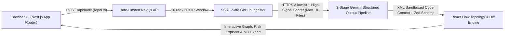

# AegisLens

**Autonomous AI System Architecture Mapper, Red-Team Security Auditor & Auto-Patch Generator**

Built for **SLAY HACKS 2026**. AegisLens transforms any public GitHub repository URL into an interactive architectural topology map, a plain-English red-team security audit, and copy-ready code patches in seconds—with zero setup and zero code retention.

---

## Problem Statement

Modern teams ship AI-assisted and full-stack codebases faster than manual security reviews can keep up. Traditional static analysis tools (SAST) produce noisy line-by-line alerts divorced from system context:
- Developers struggle to see **where** a vulnerability sits in the request lifecycle (Client → API Route → Auth → Database → External AI/Webhook).
- Hackathon and startup teams rarely configure heavy CI/CD scanners before shipping.
- Findings often lack concrete, drop-in remediation diffs.

### Why AegisLens Stands Out

1. **Zero-Setup URL-to-Audit**: Paste any public `https://github.com/owner/repo` URL—or launch an instant demo preset—and get a full architectural & security breakdown without cloning or configuring CI.
2. **Visual Topology + Risk Overlay**: Interactive `@xyflow/react` architecture graph maps Frontend, API, Auth, Database, and External Service tiers while highlighting vulnerable nodes by severity.
3. **Actionable Auto-Patch Diffs**: Every finding includes a plain-English exploit scenario, CWE/OWASP classification, and a side-by-side or unified GitHub-style code diff with one-click **Copy Fix** and **Export Markdown Report**.

---

## System Architecture



---

## Built-In Security Controls

AegisLens is engineered with defense-in-depth for untrusted repository inputs:

- **SSRF Allowlist (`src/lib/github-ingestor.ts`)**: Strictly validates `https://github.com/owner/repo` URLs with Zod, rejects non-HTTPS schemes, custom ports, credentials, query strings, and path traversal segments (`..`), and fetches only from `api.github.com` and `raw.githubusercontent.com`.
- **XML Prompt-Injection Sandboxing (`src/lib/gemini-auditor.ts`)**: Untrusted repository metadata and source files are wrapped in strict XML boundary tags (`<untrusted_repo_files>`) with explicit system instructions treating file contents as data rather than directives.
- **Sliding-Window IP Rate Limiting (`src/lib/rate-limit.ts`)**: Protects `/api/ingest` and `/api/audit` at 10 requests per 60-second window per client IP with `429` + `Retry-After` responses.
- **CSP & HTTP Security Headers (`next.config.ts`)**: Enforces `Content-Security-Policy`, `X-Frame-Options: DENY`, `X-Content-Type-Options: nosniff`, `Referrer-Policy: strict-origin-when-cross-origin`, `Permissions-Policy`, and `X-XSS-Protection`.
- **Zero Secret Persistence**: API keys (`GEMINI_API_KEY`, optional `GITHUB_TOKEN`) remain strictly server-side, and audited repository contents are processed in-memory without database retention.

---

## Quickstart Local Setup

### Prerequisites
- Node.js 20+
- A Google Gemini API key ([Google AI Studio](https://aistudio.google.com/))

### Installation

```bash
git clone https://github.com/Veeresh25/SlayHacks.git
cd SlayHacks
npm install
```

Create `.env.local` at the repository root:

```env
GEMINI_API_KEY=your_gemini_api_key_here
# Optional: increases GitHub REST API rate limit from 60/hr to 5,000/hr
GITHUB_TOKEN=your_github_pat_here
```

Start the development server:

```bash
npm run dev
```

Open [http://localhost:3000](http://localhost:3000) in your browser.

---

## Deployment Guide (Vercel)

1. Push your repository to GitHub.
2. Import the project in [Vercel](https://vercel.com/new).
3. Add `GEMINI_API_KEY` (and optionally `GITHUB_TOKEN`) under **Project Settings → Environment Variables**.
4. Deploy—Vercel automatically builds the Next.js App Router bundle and secures all routes with the headers configured in `next.config.ts`.

---

## License

Released under the [MIT License](./LICENSE).
